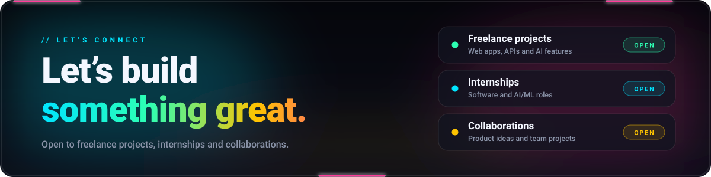

 

 

## 👋 About Me

I'm **Abu Huraira**, a **Full Stack Developer** and **AI/ML Engineer**, and a BS AI student at **Minhaj University Lahore**. I build complete web products, from the database and API to a polished, responsive interface, and I add AI where it makes the product smarter.

- 🚀 Building and deploying full-stack apps with **Django, FastAPI, React and Next.js**
- 🤖 Working on **machine learning, NLP and LLM-powered applications**
- 📱 Building mobile apps with **React Native**
- ⚙️ Solving problems in **Python and C++**
- 🌐 Shipping real projects with live deployments on **Vercel** and **Render**
- 🔭 Exploring the intersection of **AI, blockchain and autonomous agents**

## 🛠️ Tech Stack

**Languages**

**Frameworks & Libraries**

**Databases, Tools & Deployment**

**AI / ML**

## 🚀 Featured Projects

| Project | What it does | Built with | Links |
|---|---|---|---|
| 🛍️ **ShopVers Pro** | Premium full-stack e-commerce platform with search, pagination and authentication | React, Vite, Django REST, PostgreSQL | [🌐 Live](https://shopvers.me) · [💻 Code](https://github.com/abuhuraira5130/Shopvers-pro-platform) |
| 🎬 **Dispatch RAW** | AI-powered YouTube SEO platform: paste a video URL, get viral titles, hidden tags, summaries (English + Urdu) and an SEO score | React, TypeScript, Vite | [🌐 Live](https://dispatch-raw.vercel.app/) · [💻 Code](https://github.com/abuhuraira5130/Dispatch-raw) |
| 🌟 **Huraira Labs Portfolio** | My futuristic personal portfolio with animated sections and a working contact form | Next.js, React, TypeScript, Tailwind CSS, Framer Motion | [🌐 Live](https://huraira-labs.vercel.app/) · [💻 Code](https://github.com/abuhuraira5130/Huraira-portfolio) |
| 📄 **CareerForge AI** | Resume analyzer with ATS scoring, skill-gap analysis, a job tracker and mock interviews | React, Django REST, Supabase, LLMs | [💻 Code](https://github.com/abuhuraira5130/Resume_Analyzer_And-_Enhancer) |

## 📊 GitHub Stats

Live numbers from my GitHub account: contributions, top languages, streaks and activity.

 

 

## 📫 Let’s Connect

 

Prefer another mail app? Write to <a href="mailto:huraira5130@gmail.com">huraira5130@gmail.com</a>

  

